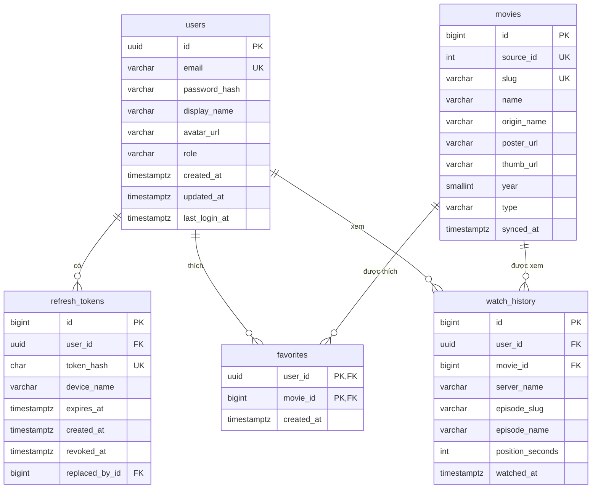

# 06 – Database & Biến môi trường

## 1. Tổng quan

| Hạng mục | Lựa chọn |
|---|---|
| Hệ quản trị CSDL | **PostgreSQL 17** (chạy bằng Docker – [docker-compose.yml](../docker-compose.yml)) |
| ORM | **EF Core 10** + `Npgsql.EntityFrameworkCore.PostgreSQL`, migration bằng `dotnet-ef` (local tool) |
| Quy ước đặt tên | `snake_case` cho bảng và cột (`EFCore.NamingConventions` → `UseSnakeCaseNamingConvention()`) |
| Thời gian | Lưu `timestamptz` (UTC), C# dùng `DateTimeOffset` / `DateTime` UTC |
| Khoá chính | `uuid` cho `users` (sinh ở app bằng `Guid.CreateVersion7()`), `bigint identity` cho các bảng còn lại |

### DB lưu gì / không lưu gì

| Lưu trong DB | **Không** lưu trong DB |
|---|---|
| Tài khoản người dùng, refresh token | Toàn bộ danh mục phim (đã có vsmov, cache bằng `IMemoryCache`) |
| Phim yêu thích, lịch sử xem | Link video / tập phim (lấy realtime từ `/api/movies/{slug}`) |
| Bản sao **tối thiểu** thông tin phim (`movies`) để hiển thị danh sách yêu thích/lịch sử mà không phải gọi nguồn | |

### Quy tắc nghiệp vụ

- **Khách** (chưa đăng nhập): duyệt, tìm kiếm, xem phim bình thường; **không** lưu yêu thích/lịch sử.
- **Đã đăng nhập**: yêu thích + lịch sử lưu trên server, dùng chung giữa các thiết bị.
- Client chỉ gửi `slug`. Backend tự lấy thông tin phim từ vsmov (qua `MovieService`, có cache) rồi **upsert** vào `movies` → không tin dữ liệu phim do client gửi lên.

## 2. Sơ đồ quan hệ (ERD)



## 3. Chi tiết bảng

### 3.1 `users`

| Cột | Kiểu | Ràng buộc | Ghi chú |
|---|---|---|---|
| `id` | `uuid` | PK | `Guid.CreateVersion7()` – sắp xếp theo thời gian |
| `email` | `varchar(255)` | NOT NULL, **UNIQUE** | Lưu dạng `trim().toLowerInvariant()` |
| `password_hash` | `varchar(100)` | NOT NULL | BCrypt (work factor 11) |
| `display_name` | `varchar(100)` | NOT NULL | |
| `avatar_url` | `varchar(500)` | NULL | |
| `role` | `varchar(20)` | NOT NULL, default `'user'` | `user` \| `admin` |
| `created_at` | `timestamptz` | NOT NULL, default `now()` | |
| `updated_at` | `timestamptz` | NOT NULL, default `now()` | Cập nhật trong `SaveChanges` |
| `last_login_at` | `timestamptz` | NULL | |

### 3.2 `refresh_tokens`

| Cột | Kiểu | Ràng buộc | Ghi chú |
|---|---|---|---|
| `id` | `bigint identity` | PK | |
| `user_id` | `uuid` | NOT NULL, FK → `users.id` **ON DELETE CASCADE** | |
| `token_hash` | `char(64)` | NOT NULL, **UNIQUE** | SHA-256 (hex) của token – **không lưu token gốc** |
| `device_name` | `varchar(100)` | NULL | VD "Pixel 7" |
| `expires_at` | `timestamptz` | NOT NULL | `now + Jwt__RefreshTokenDays` |
| `created_at` | `timestamptz` | NOT NULL, default `now()` | |
| `revoked_at` | `timestamptz` | NULL | Set khi logout / khi xoay vòng |
| `replaced_by_id` | `bigint` | NULL, FK → `refresh_tokens.id` ON DELETE SET NULL | Phục vụ phát hiện dùng lại token cũ |

Index: `ix_refresh_tokens_user_id (user_id)`.

### 3.3 `movies` (bản sao tối thiểu từ vsmov)

| Cột | Kiểu | Ràng buộc | Ghi chú |
|---|---|---|---|
| `id` | `bigint identity` | PK | |
| `source_id` | `integer` | NOT NULL, **UNIQUE** | `_id` của vsmov |
| `slug` | `varchar(150)` | NOT NULL, **UNIQUE** | Khoá tra cứu từ API |
| `name` | `varchar(255)` | NOT NULL | |
| `origin_name` | `varchar(255)` | NULL | |
| `poster_url` | `varchar(500)` | NOT NULL | |
| `thumb_url` | `varchar(500)` | NOT NULL | |
| `year` | `smallint` | NULL | |
| `type` | `varchar(20)` | NULL | `series` \| `single` \| … |
| `synced_at` | `timestamptz` | NOT NULL | Lần cuối đồng bộ từ nguồn; > 7 ngày thì cập nhật lại khi có thao tác |

### 3.4 `favorites`

| Cột | Kiểu | Ràng buộc |
|---|---|---|
| `user_id` | `uuid` | **PK (user_id, movie_id)**, FK → `users.id` ON DELETE CASCADE |
| `movie_id` | `bigint` | PK, FK → `movies.id` ON DELETE CASCADE |
| `created_at` | `timestamptz` | NOT NULL, default `now()` |

Index: `ix_favorites_user_id_created_at (user_id, created_at DESC)` – phân trang danh sách yêu thích.

### 3.5 `watch_history`

| Cột | Kiểu | Ràng buộc | Ghi chú |
|---|---|---|---|
| `id` | `bigint identity` | PK | |
| `user_id` | `uuid` | NOT NULL, FK → `users.id` ON DELETE CASCADE | |
| `movie_id` | `bigint` | NOT NULL, FK → `movies.id` ON DELETE CASCADE | |
| `server_name` | `varchar(100)` | NOT NULL | VD `Vietsub #1` |
| `episode_slug` | `varchar(50)` | NOT NULL | VD `tap-3`, `tap-full` |
| `episode_name` | `varchar(50)` | NOT NULL | VD `3`, `Full` |
| `position_seconds` | `integer` | NULL | Dự phòng – embed player hiện không cho đọc vị trí phát |
| `watched_at` | `timestamptz` | NOT NULL, default `now()` | |

- **UNIQUE (user_id, movie_id)** → mỗi phim 1 bản ghi, xem tập mới thì **upsert** (cập nhật tập + `watched_at`).
- Index: `ix_watch_history_user_id_watched_at (user_id, watched_at DESC)`.
- Giới hạn 200 bản ghi/người dùng: sau khi upsert, xoá bản ghi cũ hơn bản thứ 200.

## 4. Entity & DbContext (EF Core)

```
backend/Data/
├── AppDbContext.cs
├── Entities/        User.cs, RefreshToken.cs, Movie.cs, Favorite.cs, WatchHistory.cs
├── Configurations/  UserConfiguration.cs ... (IEntityTypeConfiguration<T>)
└── Migrations/      (sinh tự động bởi dotnet-ef)
```

```csharp
public class User
{
    public Guid Id { get; set; } = Guid.CreateVersion7();
    public required string Email { get; set; }
    public required string PasswordHash { get; set; }
    public required string DisplayName { get; set; }
    public string? AvatarUrl { get; set; }
    public string Role { get; set; } = "user";
    public DateTime CreatedAt { get; set; }
    public DateTime UpdatedAt { get; set; }
    public DateTime? LastLoginAt { get; set; }

    public List<RefreshToken> RefreshTokens { get; } = [];
    public List<Favorite> Favorites { get; } = [];
    public List<WatchHistory> WatchHistory { get; } = [];
}

public class Movie
{
    public long Id { get; set; }
    public int SourceId { get; set; }
    public required string Slug { get; set; }
    public required string Name { get; set; }
    public string? OriginName { get; set; }
    public required string PosterUrl { get; set; }
    public required string ThumbUrl { get; set; }
    public short? Year { get; set; }
    public string? Type { get; set; }
    public DateTime SyncedAt { get; set; }
}

public class Favorite
{
    public Guid UserId { get; set; }
    public long MovieId { get; set; }
    public DateTime CreatedAt { get; set; }
    public Movie Movie { get; set; } = null!;
}

public class WatchHistory
{
    public long Id { get; set; }
    public Guid UserId { get; set; }
    public long MovieId { get; set; }
    public required string ServerName { get; set; }
    public required string EpisodeSlug { get; set; }
    public required string EpisodeName { get; set; }
    public int? PositionSeconds { get; set; }
    public DateTime WatchedAt { get; set; }
    public Movie Movie { get; set; } = null!;
}
```

```csharp
// Ví dụ cấu hình
public class FavoriteConfiguration : IEntityTypeConfiguration<Favorite>
{
    public void Configure(EntityTypeBuilder<Favorite> b)
    {
        b.HasKey(x => new { x.UserId, x.MovieId });
        b.Property(x => x.CreatedAt).HasDefaultValueSql("now()");
        b.HasIndex(x => new { x.UserId, x.CreatedAt }).IsDescending(false, true);
        b.HasOne<User>().WithMany(u => u.Favorites).HasForeignKey(x => x.UserId).OnDelete(DeleteBehavior.Cascade);
        b.HasOne(x => x.Movie).WithMany().HasForeignKey(x => x.MovieId).OnDelete(DeleteBehavior.Cascade);
    }
}
```

```csharp
// Program.cs
builder.Services.AddDbContext<AppDbContext>(o => o
    .UseNpgsql(builder.Configuration.GetConnectionString("Default"))
    .UseSnakeCaseNamingConvention());
```

## 5. API sử dụng database

Tất cả `/api/me/*` yêu cầu header `Authorization: Bearer <accessToken>`.

| Method | Đường dẫn | Body | Mô tả |
|---|---|---|---|
| POST | `/api/auth/register` | `{ email, password, displayName }` | Tạo tài khoản → trả token |
| POST | `/api/auth/login` | `{ email, password, deviceName? }` | Đăng nhập → trả token |
| POST | `/api/auth/refresh` | `{ refreshToken }` | Xoay vòng: thu hồi token cũ, cấp cặp mới |
| POST | `/api/auth/logout` | `{ refreshToken }` | Thu hồi refresh token |
| GET | `/api/me` | – | Thông tin người dùng |
| GET | `/api/me/favorites?page=` | – | `PagedResult<MovieSummaryDto>` (mới nhất trước) |
| GET | `/api/me/favorites/{slug}` | – | `200 { isFavorite: true }` / `404` |
| PUT | `/api/me/favorites/{slug}` | – | Thêm (idempotent) → `204` |
| DELETE | `/api/me/favorites/{slug}` | – | Xoá → `204` |
| GET | `/api/me/history?page=` | – | `PagedResult<WatchHistoryDto>` |
| PUT | `/api/me/history/{slug}` | `{ serverName, episodeSlug, episodeName, positionSeconds? }` | Upsert → `204` |
| DELETE | `/api/me/history/{slug}` | – | Xoá 1 phim khỏi lịch sử |
| DELETE | `/api/me/history` | – | Xoá toàn bộ lịch sử |

```json
// AuthResponse
{
  "accessToken": "eyJhbGciOi...",
  "accessTokenExpiresAt": "2026-10-27T11:00:00Z",
  "refreshToken": "q8Zk...",           // chuỗi ngẫu nhiên 64 byte, base64url
  "user": { "id": "0193...", "email": "a@b.com", "displayName": "An" }
}

// WatchHistoryDto
{
  "movie": { "slug": "mua-he-dang-nho-2026", "name": "Mùa Hè Đáng Nhớ", "thumbUrl": "...", "year": 2026 },
  "serverName": "Vietsub #1", "episodeSlug": "tap-3", "episodeName": "3",
  "positionSeconds": null, "watchedAt": "2026-10-27T10:20:00Z"
}
```

### Quy tắc bảo mật

- Mật khẩu ≥ 8 ký tự; hash BCrypt; so sánh bằng `BCrypt.Verify`.
- Đăng nhập sai: trả chung `401 "Email hoặc mật khẩu không đúng"` (không tiết lộ email có tồn tại).
- Access token JWT (HS256, `Jwt__Secret`), claim `sub` = user id, hết hạn sau `Jwt__AccessTokenMinutes`.
- Refresh token: chỉ lưu hash; nếu một token **đã bị thu hồi** lại được dùng → thu hồi toàn bộ token của user đó (dấu hiệu bị đánh cắp).
- Rate limit `/api/auth/*`: 10 request/phút/IP (`AddRateLimiter`).

## 6. Biến môi trường

### 6.1 Backend – `backend/.env`

File mẫu: [backend/.env.example](../backend/.env.example). Nạp bằng `DotNetEnv` **trước** khi tạo builder:

```csharp
DotNetEnv.Env.TraversePath().Load();          // tìm .env từ thư mục hiện tại trở lên; không có file thì bỏ qua
var builder = WebApplication.CreateBuilder(args);   // đọc biến môi trường → IConfiguration
```

Dấu `__` ánh xạ sang cấp lồng của cấu hình: `Jwt__Secret` ⇔ `builder.Configuration["Jwt:Secret"]`.

| Biến | Ví dụ | Dùng cho |
|---|---|---|
| `ASPNETCORE_ENVIRONMENT` | `Development` | Môi trường |
| `ASPNETCORE_URLS` | `http://0.0.0.0:5080` | Cổng lắng nghe (0.0.0.0 để máy thật truy cập được) |
| `POSTGRES_DB` / `POSTGRES_USER` / `POSTGRES_PASSWORD` | `vsmovie` | Docker khởi tạo DB |
| `ConnectionStrings__Default` | `Host=localhost;Port=5432;Database=vsmovie;Username=vsmovie;Password=...` | EF Core |
| `Jwt__Issuer` / `Jwt__Audience` | `vsmovie-api` / `vsmovie-app` | Kiểm tra JWT |
| `Jwt__Secret` | ≥ 32 ký tự ngẫu nhiên | Ký JWT |
| `Jwt__AccessTokenMinutes` / `Jwt__RefreshTokenDays` | `30` / `30` | Thời hạn token |
| `Vsmov__BaseUrl` / `Vsmov__TimeoutSeconds` | `https://vsmov.com/api/` / `10` | Nguồn phim |
| `Cors__AllowedOrigins__0` | `*` | CORS |

> `backend/.env` đã được tạo sẵn với mật khẩu DB và JWT secret ngẫu nhiên. **Không commit** – đã chặn trong `backend/.gitignore`.

### 6.2 Mobile – `mobile/.env`

File mẫu: [mobile/.env.example](../mobile/.env.example). Không cần package – Flutter hỗ trợ sẵn:

```bash
flutter run --dart-define-from-file=.env
flutter build apk --release --dart-define-from-file=.env
```

```dart
class Env {
  static const apiBaseUrl  = String.fromEnvironment('API_BASE_URL', defaultValue: 'http://10.0.2.2:5080');
  static const apiTimeout  = int.fromEnvironment('API_TIMEOUT_SECONDS', defaultValue: 15);
  static const playerHost  = String.fromEnvironment('PLAYER_ALLOWED_HOST_SUFFIX', defaultValue: 'streamvsmov.com');
}
```

> Giá trị trong `mobile/.env` bị **nhúng vào APK** → chỉ chứa cấu hình công khai, tuyệt đối không đặt secret.
> Token đăng nhập lưu bằng `flutter_secure_storage` (Keystore/Keychain), không lưu trong `shared_preferences`.

## 7. Thao tác thường dùng

```bash
# 1. Khởi động PostgreSQL (từ thư mục btl_flutter/)
docker compose up -d
docker compose ps                       # chờ trạng thái healthy

# 2. Migration (từ thư mục backend/)
dotnet tool restore                     # cài dotnet-ef theo dotnet-tools.json
dotnet ef migrations add InitialCreate -o Data/Migrations
dotnet ef database update

# 3. Vào psql kiểm tra
docker exec -it vsmovie-db psql -U vsmovie -d vsmovie -c "\dt"

# Xoá sạch DB (mất dữ liệu!)
docker compose down -v
```

- Môi trường Development: gọi `db.Database.MigrateAsync()` khi khởi động để tự áp migration.
- Lệnh `dotnet ef` cũng đọc `.env` vì `Program.cs` gọi `Env.Load()` trước khi build host.

## 8. Ví dụ truy vấn (SQL tương đương)

```sql
-- Danh sách yêu thích, trang 1
SELECT m.slug, m.name, m.thumb_url, m.year, f.created_at
FROM favorites f JOIN movies m ON m.id = f.movie_id
WHERE f.user_id = $1
ORDER BY f.created_at DESC
LIMIT 24 OFFSET 0;

-- Upsert lịch sử xem
INSERT INTO watch_history (user_id, movie_id, server_name, episode_slug, episode_name, watched_at)
VALUES ($1, $2, $3, $4, $5, now())
ON CONFLICT (user_id, movie_id)
DO UPDATE SET server_name = EXCLUDED.server_name,
              episode_slug = EXCLUDED.episode_slug,
              episode_name = EXCLUDED.episode_name,
              watched_at   = now();
```
