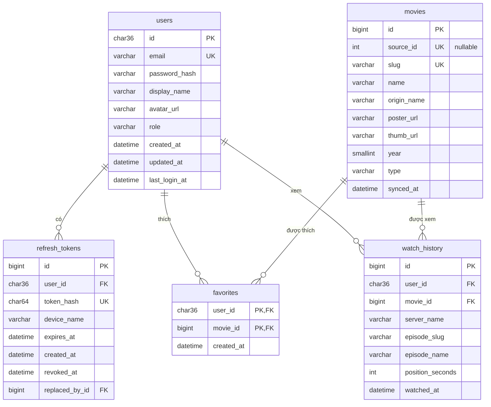

# 06 – Database & Biến môi trường

## 1. Tổng quan

| Hạng mục | Lựa chọn |
|---|---|
| Hệ quản trị CSDL | **MySQL** (server dev hiện tại: 26.7, `localhost:3306`) – database `vsmovie`, user riêng `vsmovie` |
| Charset | `utf8mb4` / `utf8mb4_unicode_ci` (đủ tiếng Việt, emoji) – engine InnoDB |
| ORM | **EF Core 10** + `MySql.EntityFrameworkCore` (provider chính thức của Oracle), migration bằng `dotnet-ef` (local tool) |
| Quy ước đặt tên | `snake_case` cho bảng và cột (`EFCore.NamingConventions` → `UseSnakeCaseNamingConvention()`) |
| Thời gian | `datetime(6)` lưu **UTC** (MySQL không có kiểu kèm múi giờ); C# dùng `DateTime` với `Kind = Utc` |
| Khoá chính | `char(36)` (Guid) cho `users` – sinh ở app bằng `Guid.CreateVersion7()`; `bigint AUTO_INCREMENT` cho các bảng còn lại |

> Vì sao không dùng Pomelo? `Pomelo.EntityFrameworkCore.MySql` mới hỗ trợ tới EF Core 9, dự án dùng .NET/EF Core 10.

### Cách vận hành

Hệ thống chạy **thủ công bằng lệnh** (`dotnet run`, `flutter run`), không đóng gói Docker.
MySQL là service riêng lắng nghe cổng `3306`. Máy dev hiện chạy MySQL trong container `mysql-dev`, nhưng backend chỉ quan tâm tới `host:port` trong connection string. MySQL cài native cũng dùng được y hệt.

### DB lưu gì / không lưu gì

| Lưu trong DB | **Không** lưu trong DB |
|---|---|
| Tài khoản người dùng, refresh token | Toàn bộ danh mục phim (đã có vsmov, cache bằng `IMemoryCache`) |
| Phim yêu thích, lịch sử xem | Link video / tập phim (lấy realtime từ `/api/movies/{slug}`) |
| Bản sao **tối thiểu** thông tin phim (`movies`) để hiển thị danh sách yêu thích/lịch sử mà không phải gọi nguồn | |

### Quy tắc nghiệp vụ

- **Khách** (chưa đăng nhập): duyệt, tìm kiếm, xem phim bình thường; **không** lưu yêu thích/lịch sử.
- **Đã đăng nhập**: yêu thích + lịch sử lưu trên server, dùng chung giữa các thiết bị.
- Client chỉ gửi `slug`. Backend tự lấy thông tin phim từ vsmov (qua `MovieService`, có cache) rồi **upsert** vào `movies` → không tin dữ liệu phim do client gửi lên.

## 2. Khởi tạo database (làm 1 lần)

Chạy bằng tài khoản `root` (đã làm sẵn trên máy dev ngày 27/10/2026):

```sql
CREATE DATABASE IF NOT EXISTS vsmovie CHARACTER SET utf8mb4 COLLATE utf8mb4_unicode_ci;
CREATE USER IF NOT EXISTS 'vsmovie'@'%' IDENTIFIED BY '<mật khẩu trong backend/.env>';
GRANT ALL PRIVILEGES ON vsmovie.* TO 'vsmovie'@'%';
FLUSH PRIVILEGES;
```

User `vsmovie` chỉ có quyền trên database `vsmovie`. **Không** dùng `root` trong connection string.

## 3. Sơ đồ quan hệ (ERD)



## 4. Chi tiết bảng

Mọi cột thời gian là `datetime(6)` lưu **UTC** và **do app gán** (`TimeProvider`/`DateTime.UtcNow`) – không dùng default của DB để tránh lệ thuộc `time_zone` của session và để test chạy được trên SQLite.

### 4.1 `users`

| Cột | Kiểu | Ràng buộc | Ghi chú |
|---|---|---|---|
| `id` | `char(36)` | PK | `Guid.CreateVersion7()` – tăng dần theo thời gian |
| `email` | `varchar(255)` | NOT NULL, **UNIQUE** | Lưu dạng `Trim().ToLowerInvariant()` |
| `password_hash` | `varchar(100)` | NOT NULL | BCrypt (work factor 11) |
| `display_name` | `varchar(100)` | NOT NULL | |
| `avatar_url` | `varchar(500)` | NULL | |
| `role` | `varchar(20)` | NOT NULL, default `'user'` | `user` \| `admin` |
| `created_at` | `datetime(6)` | NOT NULL | Gán trong `AppDbContext.SaveChangesAsync` |
| `updated_at` | `datetime(6)` | NOT NULL | Cập nhật trong `SaveChangesAsync` |
| `last_login_at` | `datetime(6)` | NULL | |

### 4.2 `refresh_tokens`

| Cột | Kiểu | Ràng buộc | Ghi chú |
|---|---|---|---|
| `id` | `bigint` AUTO_INCREMENT | PK | |
| `user_id` | `char(36)` | NOT NULL, FK → `users.id` **ON DELETE CASCADE** | |
| `token_hash` | `char(64)` | NOT NULL, **UNIQUE** | SHA-256 (hex) của token – **không lưu token gốc** |
| `device_name` | `varchar(100)` | NULL | VD "Pixel 7" |
| `expires_at` | `datetime(6)` | NOT NULL | `now + Jwt__RefreshTokenDays` |
| `created_at` | `datetime(6)` | NOT NULL | |
| `revoked_at` | `datetime(6)` | NULL | Set khi logout / khi xoay vòng |
| `replaced_by_id` | `bigint` | NULL, FK → `refresh_tokens.id` ON DELETE SET NULL | Phục vụ phát hiện dùng lại token cũ |

Index: `ix_refresh_tokens_user_id (user_id)`.

### 4.3 `movies` (bản sao tối thiểu từ vsmov)

| Cột | Kiểu | Ràng buộc | Ghi chú |
|---|---|---|---|
| `id` | `bigint` AUTO_INCREMENT | PK | |
| `source_id` | `int` | NULL, **UNIQUE** | `_id` của vsmov (MySQL cho phép nhiều NULL trong unique index). Slug đổi trên nguồn mà cùng `_id` → cập nhật bản ghi cũ |
| `slug` | `varchar(150)` | NOT NULL, **UNIQUE** | Khoá tra cứu từ API |
| `name` | `varchar(255)` | NOT NULL | |
| `origin_name` | `varchar(255)` | NULL | |
| `poster_url` | `varchar(500)` | NOT NULL | |
| `thumb_url` | `varchar(500)` | NOT NULL | |
| `year` | `smallint` | NULL | |
| `type` | `varchar(20)` | NULL | `series` \| `single` \| … |
| `synced_at` | `datetime(6)` | NOT NULL | Lần cuối đồng bộ từ nguồn; > 7 ngày thì cập nhật lại khi có thao tác |

### 4.4 `favorites`

| Cột | Kiểu | Ràng buộc |
|---|---|---|
| `user_id` | `char(36)` | **PK (user_id, movie_id)**, FK → `users.id` ON DELETE CASCADE |
| `movie_id` | `bigint` | PK, FK → `movies.id` ON DELETE CASCADE |
| `created_at` | `datetime(6)` | NOT NULL |

Index: `ix_favorites_user_id_created_at (user_id, created_at DESC)` – phân trang danh sách yêu thích.

### 4.5 `watch_history`

| Cột | Kiểu | Ràng buộc | Ghi chú |
|---|---|---|---|
| `id` | `bigint` AUTO_INCREMENT | PK | |
| `user_id` | `char(36)` | NOT NULL, FK → `users.id` ON DELETE CASCADE | |
| `movie_id` | `bigint` | NOT NULL, FK → `movies.id` ON DELETE CASCADE | |
| `server_name` | `varchar(100)` | NOT NULL | VD `Vietsub #1` |
| `episode_slug` | `varchar(50)` | NOT NULL | VD `tap-3`, `tap-full` |
| `episode_name` | `varchar(50)` | NOT NULL | VD `3`, `Full` |
| `position_seconds` | `int` | NULL | Dự phòng – embed player hiện không cho đọc vị trí phát |
| `watched_at` | `datetime(6)` | NOT NULL | |

- **UNIQUE (user_id, movie_id)** → mỗi phim 1 bản ghi, xem tập mới thì **upsert** (cập nhật tập + `watched_at`).
- Index: `ix_watch_history_user_id_watched_at (user_id, watched_at DESC)`.
- Giới hạn 200 bản ghi/người dùng: sau khi upsert, xoá bản ghi cũ hơn bản thứ 200.

## 5. Entity & DbContext (EF Core)

```
backend/Data/
├── AppDbContext.cs  (đã có khung – Phase 0)
├── Entities/        User.cs, RefreshToken.cs, Movie.cs, Favorite.cs, WatchHistory.cs
├── Configurations/  UserConfiguration.cs ... (IEntityTypeConfiguration<T>, tự nạp bằng ApplyConfigurationsFromAssembly)
└── Migrations/      (sinh tự động bởi dotnet-ef)
```

```csharp
public class User
{
    public Guid Id { get; set; } = Guid.CreateVersion7();
    public required string Email { get; set; }
    public required string PasswordHash { get; set; }
    public required string DisplayName { get; set; }
    public string? AvatarUrl { get; set; }
    public string Role { get; set; } = "user";
    public DateTime CreatedAt { get; set; }
    public DateTime UpdatedAt { get; set; }
    public DateTime? LastLoginAt { get; set; }

    public List<RefreshToken> RefreshTokens { get; } = [];
    public List<Favorite> Favorites { get; } = [];
    public List<WatchHistory> WatchHistory { get; } = [];
}

public class Movie
{
    public long Id { get; set; }
    public int SourceId { get; set; }
    public required string Slug { get; set; }
    public required string Name { get; set; }
    public string? OriginName { get; set; }
    public required string PosterUrl { get; set; }
    public required string ThumbUrl { get; set; }
    public short? Year { get; set; }
    public string? Type { get; set; }
    public DateTime SyncedAt { get; set; }
}

public class Favorite
{
    public Guid UserId { get; set; }
    public long MovieId { get; set; }
    public DateTime CreatedAt { get; set; }
    public Movie Movie { get; set; } = null!;
}

public class WatchHistory
{
    public long Id { get; set; }
    public Guid UserId { get; set; }
    public long MovieId { get; set; }
    public required string ServerName { get; set; }
    public required string EpisodeSlug { get; set; }
    public required string EpisodeName { get; set; }
    public int? PositionSeconds { get; set; }
    public DateTime WatchedAt { get; set; }
    public Movie Movie { get; set; } = null!;
}
```

```csharp
// Ví dụ cấu hình
public class UserConfiguration : IEntityTypeConfiguration<User>
{
    public void Configure(EntityTypeBuilder<User> b)
    {
        b.Property(x => x.Id).HasColumnType("char(36)");
        b.Property(x => x.Email).HasMaxLength(255);
        b.HasIndex(x => x.Email).IsUnique();
    }
}

public class FavoriteConfiguration : IEntityTypeConfiguration<Favorite>
{
    public void Configure(EntityTypeBuilder<Favorite> b)
    {
        b.HasKey(x => new { x.UserId, x.MovieId });
        b.Property(x => x.UserId).HasColumnType("char(36)");
        b.HasIndex(x => new { x.UserId, x.CreatedAt }).IsDescending(false, true);
        b.HasOne<User>().WithMany(u => u.Favorites).HasForeignKey(x => x.UserId).OnDelete(DeleteBehavior.Cascade);
        b.HasOne(x => x.Movie).WithMany().HasForeignKey(x => x.MovieId).OnDelete(DeleteBehavior.Cascade);
    }
}
```

- `ConfigureConventions`: mọi `DateTime` → `datetime(6)` + `ValueConverter` gán `DateTimeKind.Utc` khi đọc; mọi `Guid` → `char(36)`.
- Provider Oracle bỏ qua `IsDescending` (index tạo tăng dần) – không ảnh hưởng vì InnoDB đọc ngược index cho `ORDER BY ... DESC`.
- Đã kiểm tra SQL sinh ra (`dotnet ef migrations script`): đúng `char(36)`, `datetime(6)`, `char(64)`, unique/FK như bảng trên. Migration: `backend/Data/Migrations/*_InitialCreate.cs`.

```csharp
// Program.cs (đã có ở Phase 0)
builder.Services.AddDbContext<AppDbContext>(o => o
    .UseMySQL(connectionString)
    .UseSnakeCaseNamingConvention());
```

## 6. API sử dụng database

Tất cả `/api/me/*` yêu cầu header `Authorization: Bearer <accessToken>`.

| Method | Đường dẫn | Body | Mô tả |
|---|---|---|---|
| POST | `/api/auth/register` | `{ email, password, displayName }` | Tạo tài khoản → trả token |
| POST | `/api/auth/login` | `{ email, password, deviceName? }` | Đăng nhập → trả token |
| POST | `/api/auth/refresh` | `{ refreshToken }` | Xoay vòng: thu hồi token cũ, cấp cặp mới |
| POST | `/api/auth/logout` | `{ refreshToken }` | Thu hồi refresh token |
| GET | `/api/me` | – | Thông tin người dùng |
| GET | `/api/me/favorites?page=` | – | `PagedResult<MovieSummaryDto>` (mới nhất trước) |
| GET | `/api/me/favorites/{slug}` | – | `200 { isFavorite: true/false }` |
| PUT | `/api/me/favorites/{slug}` | – | Thêm (idempotent) → `204` |
| DELETE | `/api/me/favorites/{slug}` | – | Xoá → `204` |
| GET | `/api/me/history?page=` | – | `PagedResult<WatchHistoryDto>` |
| GET | `/api/me/history/{slug}` | – | `WatchHistoryDto` của phim đó / `404` nếu chưa xem (nút "Xem tiếp") |
| PUT | `/api/me/history/{slug}` | `{ serverName, episodeSlug, episodeName, positionSeconds? }` | Upsert → `204` |
| DELETE | `/api/me/history/{slug}` | – | Xoá 1 phim khỏi lịch sử |
| DELETE | `/api/me/history` | – | Xoá toàn bộ lịch sử |

```json
// AuthResponse
{
  "accessToken": "eyJhbGciOi...",
  "accessTokenExpiresAt": "2026-10-27T11:00:00Z",
  "refreshToken": "q8Zk...",           // chuỗi ngẫu nhiên 64 byte, base64url
  "user": { "id": "0193...", "email": "a@b.com", "displayName": "An" }
}

// WatchHistoryDto
{
  "movie": { "slug": "mua-he-dang-nho-2026", "name": "Mùa Hè Đáng Nhớ", "thumbUrl": "...", "year": 2026 },
  "serverName": "Vietsub #1", "episodeSlug": "tap-3", "episodeName": "3",
  "positionSeconds": null, "watchedAt": "2026-10-27T10:20:00Z"
}
```

### Quy tắc bảo mật

- Mật khẩu ≥ 8 ký tự; hash BCrypt; so sánh bằng `BCrypt.Verify`.
- Đăng nhập sai: trả chung `401 "Email hoặc mật khẩu không đúng"` (không tiết lộ email có tồn tại).
- Email trùng khi đăng ký → `409`. Bắt `DbUpdateException` do unique index phòng trường hợp 2 request đồng thời.
- Access token JWT (HS256, `Jwt__Secret`), claim `sub` = user id, hết hạn sau `Jwt__AccessTokenMinutes`.
- Refresh token: chỉ lưu hash; nếu một token **đã bị thu hồi** lại được dùng → thu hồi toàn bộ token của user đó (dấu hiệu bị đánh cắp).
- Rate limit `/api/auth/*`: 10 request/phút/IP (`AddRateLimiter`).

## 7. Biến môi trường

### 7.1 Backend – `backend/.env`

File mẫu: [backend/.env.example](../backend/.env.example). Nạp bằng `DotNetEnv` **trước** khi tạo builder (đã có trong `Program.cs`):

```csharp
DotNetEnv.Env.TraversePath().Load();                // tìm .env từ thư mục hiện tại trở lên; không có file thì bỏ qua
var builder = WebApplication.CreateBuilder(args);   // đọc biến môi trường → IConfiguration
```

Dấu `__` ánh xạ sang cấp lồng của cấu hình: `Jwt__Secret` ⇔ `builder.Configuration["Jwt:Secret"]`.
Giá trị trong `.env` **ghi đè** `appsettings*.json` và cả `launchSettings.json`.

| Biến | Ví dụ | Dùng cho |
|---|---|---|
| `ASPNETCORE_ENVIRONMENT` | `Development` | Môi trường |
| `ASPNETCORE_URLS` | `http://0.0.0.0:5080` | Cổng lắng nghe (0.0.0.0 để máy thật truy cập được) |
| `ConnectionStrings__Default` | `Server=localhost;Port=3306;Database=vsmovie;User=vsmovie;Password=...;CharSet=utf8mb4` | EF Core / MySQL |
| `Jwt__Issuer` / `Jwt__Audience` | `vsmovie-api` / `vsmovie-app` | Kiểm tra JWT |
| `Jwt__Secret` | ≥ 32 ký tự ngẫu nhiên | Ký JWT (thiếu hoặc ngắn hơn → app dừng khi khởi động) |
| `Jwt__AccessTokenMinutes` / `Jwt__RefreshTokenDays` | `30` / `30` | Thời hạn token |
| `Vsmov__BaseUrl` / `Vsmov__TimeoutSeconds` | `https://vsmov.com/api/` / `10` | Nguồn phim |
| `Cors__AllowedOrigins__0` | `*` | CORS |

> `backend/.env` đã được tạo sẵn với mật khẩu của user `vsmovie` và JWT secret ngẫu nhiên. **Không commit** – đã chặn trong `backend/.gitignore`.

### 7.2 Mobile – `mobile/.env`

File mẫu: [mobile/.env.example](../mobile/.env.example). Không cần package – Flutter hỗ trợ sẵn:

```bash
flutter run --dart-define-from-file=.env
flutter build apk --release --dart-define-from-file=.env
```

Đọc trong code qua `lib/app/env.dart` (`Env.apiBaseUrl`, `Env.apiTimeoutSeconds`, `Env.playerAllowedHostSuffix`).

> Giá trị trong `mobile/.env` bị **nhúng vào APK** → chỉ chứa cấu hình công khai, tuyệt đối không đặt secret.
> Token đăng nhập lưu bằng `flutter_secure_storage` (Keystore/Keychain), không lưu trong `shared_preferences`.

## 8. Thao tác thường dùng

```bash
# Kiểm tra backend kết nối được MySQL
cd backend
dotnet run
curl http://localhost:5080/health        # {"status":"ok","database":"up"}

# Migration (tại backend/)
dotnet tool restore                      # cài dotnet-ef theo dotnet-tools.json
dotnet ef migrations add InitialCreate -o Data/Migrations
dotnet ef database update
dotnet ef migrations script -o migrate.sql   # xuất SQL nếu cần chạy tay

# Xem bảng – dùng MySQL Workbench / DBeaver / HeidiSQL (localhost:3306, user vsmovie)
# hoặc mysql client có sẵn trong container dev:
docker exec -it mysql-dev mysql -uvsmovie -p vsmovie -e "SHOW TABLES;"

# Xoá sạch dữ liệu (mất dữ liệu!) rồi tạo lại từ migration
dotnet ef database drop --force
dotnet ef database update
```

- Môi trường Development: `Program.cs` gọi `db.Database.MigrateAsync()` khi khởi động (MySQL chưa lên thì ghi log lỗi, app vẫn chạy và `/health` báo `database: down`).
- `dotnet ef` cũng đọc `.env` vì `Program.cs` gọi `Env.Load()` trước khi build host.
- `dotnet ef database drop` cần quyền DROP – user `vsmovie` có `ALL PRIVILEGES` trên `vsmovie.*` nên đủ; nếu tạo lại DB sau khi drop, EF tạo với charset mặc định của server (`utf8mb4`).

## 9. Ví dụ truy vấn (SQL tương đương)

```sql
-- Danh sách yêu thích, trang 1
SELECT m.slug, m.name, m.thumb_url, m.year, f.created_at
FROM favorites f JOIN movies m ON m.id = f.movie_id
WHERE f.user_id = ?
ORDER BY f.created_at DESC
LIMIT 24 OFFSET 0;

-- Upsert lịch sử xem
INSERT INTO watch_history (user_id, movie_id, server_name, episode_slug, episode_name, watched_at)
VALUES (?, ?, ?, ?, ?, UTC_TIMESTAMP(6))
ON DUPLICATE KEY UPDATE
    server_name  = VALUES(server_name),
    episode_slug = VALUES(episode_slug),
    episode_name = VALUES(episode_name),
    watched_at   = UTC_TIMESTAMP(6);
```

> Thời gian luôn do app gán (UTC) nên không phụ thuộc `time_zone` của MySQL. Service thực tế dùng EF (đọc → sửa → `SaveChanges`) thay cho `ON DUPLICATE KEY`; unique index `(user_id, movie_id)` là chốt chặn cuối khi 2 request chạy song song.

## 10. Mã nguồn & kiểm thử (Phase 5 – 6)

| Phần | File |
|---|---|
| Entity / cấu hình bảng | `backend/Data/Entities/*.cs`, `backend/Data/Configurations/EntityConfigurations.cs` |
| DbContext + quy ước UTC | `backend/Data/AppDbContext.cs` |
| JWT + refresh token | `backend/Auth/TokenService.cs`, `backend/Auth/JwtOptions.cs` |
| Đăng ký / đăng nhập / xoay vòng | `backend/Services/AuthService.cs` → `Endpoints/AuthEndpoints.cs` |
| Yêu thích / lịch sử | `backend/Services/LibraryService.cs` → `Endpoints/MeEndpoints.cs` |
| Mobile: lưu token, tự refresh | `mobile/lib/core/token_storage.dart`, `mobile/lib/core/auth_interceptor.dart` |
| Mobile: state | `mobile/lib/features/auth/auth_providers.dart`, `mobile/lib/features/library/library_providers.dart` |

- **Test backend** (`backend.Tests/AuthApiTests.cs`, `LibraryApiTests.cs`): chạy toàn bộ API qua `WebApplicationFactory`, DB là **SQLite in-memory** (user `vsmovie` không có quyền tạo DB test trên MySQL), vsmov giả trả `docs/samples`.
- **Đã chạy thật với MySQL** (27/10/2026): đăng ký → 409 email trùng → 401 sai mật khẩu → yêu thích / lịch sử → refresh xoay vòng → dùng lại token cũ thu hồi cả 2 token → `/api/auth` request thứ 11/phút trả `429`. Tiếng Việt lưu đúng utf8mb4 (`Mùa` = `4D C3 B9`).
- Giới hạn `/api/auth/*`: cấu hình bằng `RateLimit__AuthPermitPerMinute` (mặc định 10).
